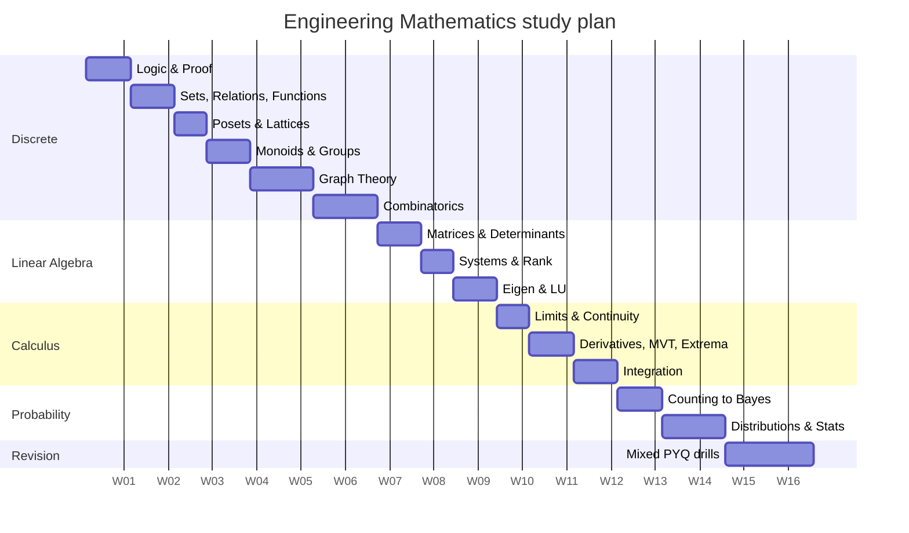

# Engineering Mathematics — From Zero to GATE 2027 (CS/IT)

**Scope:** Section 1 of the GATE 2027 (IIT Madras) CS & IT syllabus, in full:
Discrete Mathematics · Linear Algebra · Calculus · Probability and Statistics.

**Design contract for this document**

| Promise | What it means here |
|---|---|
| No assumed background | Every symbol is defined the first time it appears. Nothing is "obvious". |
| Pedagogically rigorous | Definitions precede examples; theorems are stated precisely; intuition is labelled as intuition, never substituted for proof. |
| Exam-calibrated | Problems are in GATE's 1-mark / 2-mark style, with full step-by-step solutions. |
| Visual | Every concept carries a **Diagram** spec and an **Animation** spec you (or a designer/LLM) can build directly. |

> Every numeric answer in this document was computed and cross-checked in a Python sandbox, not done mentally.

**How to read the symbol tables.** Mathematics is a language with a small alphabet. Learn the alphabet once and the sentences become readable. Each module opens with its glossary — read it, don't skip it.

**Suggested schedule (14 weeks, ~10 h/week)**

---
---

# MODULE 1 — DISCRETE MATHEMATICS

Discrete mathematics is the mathematics of **separate, countable things** — statements that are true or false, elements in a set, nodes in a network — as opposed to continuous things like smoothly flowing time. It is the single highest-yield GATE topic because computers themselves are discrete machines.

## 1.0 Module glossary

| Symbol | Read aloud | Meaning |
|---|---|---|
| $\neg p$ | "not p" | Negation: flips true to false |
| $p \wedge q$ | "p and q" | Conjunction: true only when both are true |
| $p \vee q$ | "p or q" | Disjunction: true when at least one is true |
| $p \rightarrow q$ | "p implies q" | Conditional: false **only** when $p$ true and $q$ false |
| $p \leftrightarrow q$ | "p if and only if q" | Biconditional: true when both have the same truth value |
| $\equiv$ | "is logically equivalent to" | Two formulas with identical truth tables |
| $\forall x$ | "for all x" | Universal quantifier |
| $\exists x$ | "there exists an x" | Existential quantifier |
| $\in$ / $\notin$ | "is an element of" | Membership in a set |
| $\subseteq$ / $\subset$ | "is a subset of" / "proper subset" | Containment |
| $\cup,\ \cap,\ \setminus,\ \overline{A}$ | union, intersection, difference, complement | Set operations |
| $|A|$ | "cardinality of A" | Number of elements in $A$ |
| $\mathcal{P}(A)$ or $2^A$ | "power set of A" | The set of all subsets of $A$ |
| $A \times B$ | "A cross B" | Cartesian product: all ordered pairs $(a,b)$ |
| $aRb$ | "a is related to b" | The pair $(a,b)$ is in relation $R$ |
| $\preceq$ | "precedes or equals" | A partial order |
| $\vee,\ \wedge$ (lattices) | join, meet | Least upper bound, greatest lower bound |
| $\binom{n}{r}$ | "n choose r" | Number of $r$-element subsets of an $n$-set |
| $n!$ | "n factorial" | $n\times(n-1)\times\cdots\times 1$, with $0! = 1$ |
| $\deg(v)$ | "degree of v" | Number of edge-ends at vertex $v$ |
| $\chi(G)$ | "chi of G" | Chromatic number: fewest colours to properly colour $G$ |

---

## 1.1 Propositional Logic

### 1.1.1 First principles

A **proposition** is a declarative sentence that is definitely either **true (T)** or **false (F)**, never both, never neither.

- "7 is a prime number." → a proposition (T).
- "Delhi is the capital of France." → a proposition (F).
- "What time is it?" → *not* a proposition (a question has no truth value).
- "$x > 5$" → *not* a proposition until $x$ is fixed; this is a **predicate** (Section 1.2).

We abbreviate propositions with letters $p, q, r$ called **propositional variables**. A **connective** combines propositions into larger ones. The entire subject rests on five connectives, and each is *defined* by a truth table — nothing more, nothing less.

**The five connectives, defined completely**

| $p$ | $q$ | $\neg p$ | $p\wedge q$ | $p \vee q$ | $p \rightarrow q$ | $p \leftrightarrow q$ |
|:-:|:-:|:-:|:-:|:-:|:-:|:-:|
| T | T | F | T | T | T | T |
| T | F | F | F | T | **F** | F |
| F | T | T | F | T | T | F |
| F | F | T | F | F | T | T |

**The one row everyone gets wrong.** $p \rightarrow q$ is **true** whenever $p$ is false. "If the moon is made of cheese, then I am the king" is a *true* statement, because a promise with a condition that never occurs is never broken. This is called **vacuous truth**. Memorise: *an implication is false in exactly one situation — true premise, false conclusion.*

### 1.1.2 Tautology, contradiction, contingency

- **Tautology:** true in every row of its truth table. Example: $p \vee \neg p$.
- **Contradiction:** false in every row. Example: $p \wedge \neg p$.
- **Contingency:** neither — some rows T, some F.
- **Satisfiable:** true in *at least one* row. (Tautologies are satisfiable; contradictions are not.)

A formula with $n$ distinct variables has $2^n$ rows, because each variable independently takes 2 values.

### 1.1.3 The equivalence laws (your algebra toolkit)

$\equiv$ means "same truth table". These let you rewrite formulas the way you rewrite algebra.

| Law | Statement |
|---|---|
| Identity | $p \wedge T \equiv p$;  $p \vee F \equiv p$ |
| Domination | $p \vee T \equiv T$;  $p \wedge F \equiv F$ |
| Idempotent | $p \vee p \equiv p$;  $p \wedge p \equiv p$ |
| Double negation | $\neg(\neg p) \equiv p$ |
| Commutative | $p \vee q \equiv q \vee p$ |
| Associative | $(p\vee q)\vee r \equiv p \vee (q \vee r)$ |
| Distributive | $p\vee(q\wedge r) \equiv (p\vee q)\wedge(p \vee r)$ |
| **De Morgan** | $\neg(p\wedge q)\equiv \neg p \vee \neg q$;  $\neg(p\vee q)\equiv \neg p\wedge\neg q$ |
| Absorption | $p\vee(p\wedge q)\equiv p$ |
| Negation | $p \vee \neg p \equiv T$;  $p\wedge\neg p\equiv F$ |
| **Implication** | $p \rightarrow q \equiv \neg p \vee q$ |
| **Contrapositive** | $p\rightarrow q \equiv \neg q \rightarrow \neg p$ |
| Biconditional | $p\leftrightarrow q \equiv (p\rightarrow q)\wedge(q\rightarrow p)$ |

**The single most useful identity for GATE:** $p\rightarrow q \equiv \neg p \vee q$. Convert every implication to an OR immediately; the rest becomes mechanical.

**Converse, inverse, contrapositive** — given $p \rightarrow q$:

| Name | Form | Equivalent to original? |
|---|---|---|
| Converse | $q \rightarrow p$ | ❌ No |
| Inverse | $\neg p \rightarrow \neg q$ | ❌ No |
| Contrapositive | $\neg q \rightarrow \neg p$ | ✅ **Yes** |

(Converse and inverse are equivalent to *each other*, since each is the contrapositive of the other.)

### 1.1.4 Normal forms

- **Literal:** a variable or its negation ($p$, $\neg q$).
- **CNF (Conjunctive Normal Form):** an AND of ORs — $(p\vee \neg q)\wedge(q \vee r)$. Used by SAT solvers.
- **DNF (Disjunctive Normal Form):** an OR of ANDs — $(p\wedge q)\vee(\neg p \wedge r)$. Read directly off the T-rows of a truth table.

### 1.1.5 Rules of inference

An **argument** is valid if whenever all premises are true, the conclusion must be true.

| Rule | Premises | Conclusion |
|---|---|---|
| Modus Ponens | $p\rightarrow q$, $p$ | $q$ |
| Modus Tollens | $p\rightarrow q$, $\neg q$ | $\neg p$ |
| Hypothetical Syllogism | $p\rightarrow q$, $q \rightarrow r$ | $p \rightarrow r$ |
| Disjunctive Syllogism | $p \vee q$, $\neg p$ | $q$ |
| Resolution | $p\vee q$, $\neg p \vee r$ | $q \vee r$ |

### 1.1.6 Worked problems

**Problem 1.1 (1 mark).** Show that $\big[(p\rightarrow q)\wedge(q\rightarrow r)\big]\rightarrow(p\rightarrow r)$ is a tautology.

*Solution — method A, truth table (8 rows).*

| $p$ | $q$ | $r$ | $p\!\rightarrow\! q$ | $q\!\rightarrow\! r$ | LHS $=$ AND | $p\!\rightarrow\! r$ | Whole formula |
|:-:|:-:|:-:|:-:|:-:|:-:|:-:|:-:|
| T|T|T| T|T| T |T| **T** |
| T|T|F| T|F| F |F| **T** |
| T|F|T| F|T| F |T| **T** |
| T|F|F| F|T| F |F| **T** |
| F|T|T| T|T| T |T| **T** |
| F|T|F| T|F| F |T| **T** |
| F|F|T| T|T| T |T| **T** |
| F|F|F| T|T| T |T| **T** |

Final column is all T ⟹ tautology. *(Verified by exhaustive machine check over all 8 assignments.)*

*Solution — method B, the exam-speed route.* Assume the whole formula is **false**. Then LHS = T and $p\rightarrow r$ = F. From $p \rightarrow r$ = F: $p$=T, $r$=F. From LHS: $p\rightarrow q$=T with $p$=T forces $q$=T. Then $q\rightarrow r$ = T→F = F, so LHS = F. Contradiction. No falsifying row exists ⟹ tautology. ∎

**Problem 1.2 (1 mark).** How many of the 8 assignments satisfy $(p\vee q)\wedge(\neg q \vee r)$?

*Solution.* Enumerate only where $p \vee q$ = T (that kills $p=q=$F):

| $p,q,r$ | $p\vee q$ | $\neg q \vee r$ | AND |
|---|:-:|:-:|:-:|
| T,T,T | T | T | ✅ |
| T,T,F | T | F | ✗ |
| T,F,T | T | T | ✅ |
| T,F,F | T | T | ✅ |
| F,T,T | T | T | ✅ |
| F,T,F | T | F | ✗ |

**Answer: 4** satisfying assignments. (Machine-verified.) Note the formula is satisfiable but not a tautology.

**Problem 1.3 (2 marks).** Simplify $\neg(p \rightarrow q) \vee (p \wedge \neg q)$.

*Solution.*
1. $p\rightarrow q \equiv \neg p \vee q$ (implication law).
2. $\neg(\neg p \vee q) \equiv p \wedge \neg q$ (De Morgan + double negation).
3. Expression becomes $(p\wedge\neg q)\vee(p\wedge\neg q) \equiv p \wedge \neg q$ (idempotent). ∎

**Problem 1.4 (2 marks).** "If it rains, the match is cancelled. The match was not cancelled." What follows?

*Solution.* Let $p$ = "it rains", $q$ = "match cancelled". Premises: $p \rightarrow q$ and $\neg q$. By **Modus Tollens**, conclude $\neg p$: **it did not rain**. The tempting wrong answer — concluding from "the match was cancelled" that it rained — is the fallacy of *affirming the consequent* (using the invalid converse). ∎

### 1.1.7 Visuals

> **Diagram D1.1 — "The Implication Gate."** A 2×2 grid of cells, rows = $p$ (T/F), columns = $q$ (T/F). Three cells are filled soft green with a ✓; the single cell (p=T, q=F) is filled red with a ✗ and labelled "the only broken promise". Beside it, a cartoon: a vending machine with the rule "insert coin → get snack"; the machine only *breaks its promise* if a coin went in and no snack came out. No coin inserted = promise untested = still honest.

> **Diagram D1.2 — Connective Venn panel.** Four Venn diagrams of two overlapping circles $p$, $q$ on a rectangular universe, shaded for $p\wedge q$ (lens only), $p \vee q$ (both circles), $p \rightarrow q$ (everything except the $p$-only crescent), $\neg p$ (everything outside $p$). Placing them side by side makes $p\rightarrow q \equiv \neg p \vee q$ visually self-evident.

> **Animation A1.1 — Truth-table sweep.** A formula sits at the top with its parse tree below. A highlighted row of the truth table advances once per second; as it does, truth values (green T / red F) propagate *upward* through the parse tree leaves to the root, and the root's value is stamped into the final column. When all 8 rows finish green, a banner reads "TAUTOLOGY". Give the learner a toggle to edit the formula and re-run.

> **Animation A1.2 — De Morgan morph.** Start with a shaded Venn region for $\neg(p \wedge q)$. The shading continuously flows and resolves into the union of $\neg p$ and $\neg q$, while the written formula morphs character-by-character. Shows *why* the negation "distributes and flips the connective".

---

## 1.2 First-Order (Predicate) Logic

### 1.2.1 Why we need more than propositions

"Every student passed" and "Some student passed" are different claims, yet propositional logic can only call each a single opaque letter. First-order logic looks *inside* the sentence.

- **Predicate:** a statement with slots, e.g. $P(x)$ = "$x$ is prime". $P(7)$ is T; $P(8)$ is F.
- **Domain (universe of discourse) $D$:** the set the variables range over. **Always state it** — truth depends on it. $\forall x\,(x^2 \ge 0)$ is true over the reals, meaningless over "all people".
- **Quantifiers:** $\forall x\,P(x)$ ("for every $x$ in $D$, $P(x)$ holds"); $\exists x\,P(x)$ ("for at least one $x$ in $D$").

### 1.2.2 The two translation templates (memorise these)

| English | Correct logic | Why the other connective fails |
|---|---|---|
| "All $A$ are $B$" | $\forall x\,(A(x) \rightarrow B(x))$ | Using $\wedge$ would claim *everything in the universe* is both an $A$ and a $B$. |
| "Some $A$ is $B$" | $\exists x\,(A(x) \wedge B(x))$ | Using $\rightarrow$ would be satisfied vacuously by any non-$A$ object — a free pass. |

Pattern: **$\forall$ pairs with $\rightarrow$; $\exists$ pairs with $\wedge$.**

### 1.2.3 Negation (quantifier duality)

$$\neg\forall x\,P(x) \equiv \exists x\,\neg P(x) \qquad\qquad \neg\exists x\,P(x) \equiv \forall x\,\neg P(x)$$

To negate: **push the $\neg$ inward, flipping every quantifier as it passes, and negate the body.** "Not everyone is happy" = "someone is unhappy".

### 1.2.4 Nested quantifiers — order matters

Let $L(x,y)$ = "$x$ loves $y$" over the domain of people.

| Formula | English | Strength |
|---|---|---|
| $\forall x\,\exists y\,L(x,y)$ | Everyone loves *someone* (possibly different each) | weaker |
| $\exists y\,\forall x\,L(x,y)$ | There is one person loved by *everyone* | **stronger** |

$\exists y\,\forall x$ implies $\forall x\,\exists y$, but **not** conversely. Same-type quantifiers commute ($\forall x \forall y \equiv \forall y \forall x$); mixed ones do not. This asymmetry is a perennial GATE question.

**Free vs bound.** In $\forall x\,(P(x) \wedge Q(y))$, $x$ is **bound** (captured by a quantifier) and $y$ is **free**. A formula with no free variables is a **sentence** and has a definite truth value.

### 1.2.5 Worked problems

**Problem 1.5 (2 marks).** Domain = all students. $C(x)$: "$x$ studies compilers". $N(x)$: "$x$ studies networks". Translate: "No student studies both compilers and networks", then negate it.

*Solution.*
Statement: $\neg\exists x\,(C(x)\wedge N(x))$, equivalently $\forall x\,\neg(C(x)\wedge N(x))$, equivalently $\forall x\,(C(x)\rightarrow \neg N(x))$ — all three are the same claim.
Negation: $\exists x\,(C(x)\wedge N(x))$ — "some student studies both". ∎

**Problem 1.6 (2 marks).** Which is true over $D = \mathbb{Z}$ (integers), where $S(x,y)$ means $x + y = 0$?
(a) $\forall x\,\exists y\,S(x,y)$  (b) $\exists y\,\forall x\,S(x,y)$

*Solution.*
(a) Given any integer $x$, choose $y = -x$; then $x+y=0$. ✅ **True.**
(b) Claims one fixed $y$ works for *every* $x$. Take that $y$; it fails for $x = 1 - y$ since $(1-y)+y = 1 \ne 0$. ❌ **False.**
Moral: the inner variable may depend on the outer one, never the reverse. ∎

### 1.2.6 Visuals

> **Diagram D1.3 — Quantifier-order grid.** An $n \times n$ grid of cells; rows = people $x$, columns = people $y$; a filled dot at $(x,y)$ means $L(x,y)$. $\forall x \exists y$ = "every **row** has at least one dot". $\exists y \forall x$ = "some **column** is completely full". Two side-by-side grids: one with a dot scattered in each row (satisfies the first, not the second), one with a solid column (satisfies both). This single picture resolves most quantifier confusion permanently.

> **Animation A1.3 — Negation push-down.** Display $\neg \forall x \exists y\, (P(x) \wedge \neg Q(y))$. A glowing $\neg$ token travels left-to-right through the formula; each quantifier it crosses visibly flips ($\forall \to \exists$, $\exists \to \forall$) with a snap, and the final body expands by De Morgan. Learner presses "step" to advance one push at a time.

---

## 1.3 Sets, Relations, Functions

### 1.3.1 Sets from scratch

A **set** is an unordered collection of distinct objects, called its **elements**. Notation: $A = \{1,2,3\}$, or set-builder $A = \{x \mid x \text{ is an even integer}, 0 < x < 10\}$ ("the set of all $x$ such that…").

- Order and repetition are irrelevant: $\{1,2,2,3\} = \{3,1,2\}$.
- **Empty set** $\emptyset = \{\}$, with $|\emptyset| = 0$. Note $\emptyset \ne \{\emptyset\}$: the second is a *box containing an empty box*, so $|\{\emptyset\}| = 1$.
- $A \subseteq B$ iff every element of $A$ is in $B$. $\emptyset \subseteq A$ always.
- **Power set** $\mathcal{P}(A)$ = all subsets of $A$. If $|A| = n$ then $|\mathcal{P}(A)| = 2^n$ — because building a subset means making $n$ independent in/out decisions.
- **Cartesian product** $A\times B = \{(a,b) \mid a \in A, b\in B\}$, with $|A\times B| = |A|\cdot|B|$. Here order *does* matter: $(1,2)\ne(2,1)$.

**Operations.** $A\cup B$ (in either), $A\cap B$ (in both), $A \setminus B$ (in $A$, not $B$), $\overline{A} = U \setminus A$ (complement w.r.t. universe $U$), $A \oplus B$ (symmetric difference: in exactly one).

**Inclusion–Exclusion Principle (IEP)** — the correction for double counting:
$$|A \cup B| = |A| + |B| - |A\cap B|$$
$$|A\cup B\cup C| = |A|+|B|+|C| - |A\cap B| - |A\cap C| - |B\cap C| + |A\cap B\cap C|$$
General pattern: add singles, subtract pairs, add triples, alternating.

### 1.3.2 Relations

A **binary relation** $R$ from $A$ to $B$ is any subset $R \subseteq A \times B$. We write $aRb$ for $(a,b)\in R$. On a set $A$ of size $n$ there are $2^{n^2}$ possible relations (each of the $n^2$ pairs is independently in or out).

**The five properties** (relation $R$ on set $A$):

| Property | Definition | Plain meaning |
|---|---|---|
| Reflexive | $\forall a\,(aRa)$ | everything relates to itself |
| Irreflexive | $\forall a\,\neg(aRa)$ | nothing relates to itself |
| Symmetric | $aRb \Rightarrow bRa$ | always mutual |
| Antisymmetric | $aRb \wedge bRa \Rightarrow a = b$ | mutual only in the trivial case |
| Transitive | $aRb \wedge bRc \Rightarrow aRc$ | shortcuts always exist |

Antisymmetric is **not** the negation of symmetric; a relation can be both (e.g. equality) or neither.

**Equivalence relation** = reflexive + symmetric + transitive. Its effect is to **partition** $A$ into disjoint **equivalence classes** $[a] = \{x \mid xRa\}$. Classic example: "congruent mod 3" on integers splits $\mathbb{Z}$ into exactly 3 classes. Key theorem: *equivalence relations on $A$ correspond one-to-one with partitions of $A$.*

**Partial order** = reflexive + antisymmetric + transitive (next section).

### 1.3.3 Functions

A **function** $f: A \to B$ assigns to **each** $a \in A$ **exactly one** $b \in B$. $A$ is the **domain**, $B$ the **codomain**, and $\{f(a) \mid a \in A\}$ the **range** (range $\subseteq$ codomain).

| Type | Condition | Intuition |
|---|---|---|
| **Injective** (one-to-one) | $f(a_1)=f(a_2) \Rightarrow a_1=a_2$ | no two inputs share an output |
| **Surjective** (onto) | range $=$ codomain | every output is hit |
| **Bijective** | both | perfect pairing; $f^{-1}$ exists |

Counting (for $|A| = m$, $|B| = n$): total functions $n^m$; injective functions $n(n-1)\cdots(n-m+1)$ (needs $n \ge m$); surjective functions $\sum_{k=0}^{n}(-1)^k\binom{n}{k}(n-k)^m$ (by IEP); bijections (when $m=n$) $n!$.

**Pigeonhole Principle.** If $m$ objects go into $n$ boxes with $m > n$, some box holds $\ge 2$ objects. Generalised: some box holds $\ge \lceil m/n \rceil$ objects. ($\lceil\cdot\rceil$ = ceiling, round up.)

### 1.3.4 Worked problems

**Problem 1.7 (2 marks).** Among the integers $1$ to $1000$, how many are divisible by 3, 5, or 7? How many by none of them?

*Solution.* Let $A,B,C$ be the sets divisible by 3, 5, 7. Use $|A| = \lfloor 1000/3 \rfloor$ etc. ($\lfloor\cdot\rfloor$ = floor, round down).

| Term | Count |
|---|---|
| $\lfloor 1000/3\rfloor$ | 333 |
| $\lfloor 1000/5\rfloor$ | 200 |
| $\lfloor 1000/7\rfloor$ | 142 |
| $\lfloor 1000/15\rfloor$ | 66 |
| $\lfloor 1000/21\rfloor$ | 47 |
| $\lfloor 1000/35\rfloor$ | 28 |
| $\lfloor 1000/105\rfloor$ | 9 |

$$|A\cup B\cup C| = 333+200+142-66-47-28+9 = \mathbf{543}$$
None of them: $1000 - 543 = \mathbf{457}$. *(Both figures machine-computed.)* ∎

**Problem 1.8 (2 marks).** How many equivalence relations are there on a 4-element set?

*Solution.* Equivalence relations ↔ partitions, so count partitions of a 4-set = Bell number $B_4$. Break by number of blocks using Stirling numbers of the second kind $S(4,k)$:

| Blocks $k$ | $S(4,k)$ | Shape |
|:-:|:-:|---|
| 1 | 1 | $\{abcd\}$ |
| 2 | 7 | $3+1$ (4 ways) and $2+2$ (3 ways) |
| 3 | 6 | $2+1+1$ (choose the pair: $\binom{4}{2}=6$) |
| 4 | 1 | all singletons |

$$B_4 = 1+7+6+1 = \mathbf{15}$$ *(Machine-verified via the recurrence $S(n,k)=k\,S(n-1,k)+S(n-1,k-1)$.)* ∎

**Problem 1.9 (1 mark).** $f:\mathbb{R}\to\mathbb{R}$, $f(x) = x^2$. Classify it. Then classify $g:\mathbb{R}\to[0,\infty)$, $g(x)=x^2$, and $h:[0,\infty)\to[0,\infty)$, $h(x)=x^2$.

*Solution.*
- $f$: not injective ($f(-2)=f(2)=4$); not surjective (no $x$ gives $-1$). **Neither.**
- $g$: codomain trimmed to the actual range ⟹ **surjective, not injective.**
- $h$: domain restricted to non-negatives ⟹ **bijective**, inverse $h^{-1}(y)=\sqrt{y}$.
Moral: injectivity/surjectivity are properties of the *triple* (rule, domain, codomain), never of the formula alone. ∎

**Problem 1.10 (1 mark).** Show that among any 13 people, two share a birth month.

*Solution.* Objects = 13 people, boxes = 12 months, $13 > 12$ ⟹ by pigeonhole some month holds $\ge \lceil 13/12 \rceil = 2$ people. ∎

### 1.3.5 Visuals

> **Diagram D1.4 — Three-circle Venn with populated regions.** Circles for "÷3", "÷5", "÷7" inside a box labelled "1…1000". Each of the 8 regions carries its *exact* count derived by peeling the IEP from the inside out: centre 9; the three pairwise-only regions 57, 38, 19; the three single-only regions 219, 126, 84; outside 457. A running total strip underneath confirms the eight regions sum to 1000 — a built-in self-check that teaches IEP better than the formula does.

> **Diagram D1.5 — Function-type bestiary.** Four bipartite "bubble and arrow" panels (left oval = domain dots, right oval = codomain dots): *not a function* (one dot with two outgoing arrows, marked ✗), *injective not surjective* (arrows never collide, one right-dot unhit), *surjective not injective* (two arrows merge, all right-dots hit), *bijective* (perfect matching, with a dashed reverse arrow showing $f^{-1}$).

> **Animation A1.6 — Partition ↔ equivalence relation.** Left panel: 4 dots that the learner drags into groups. Right panel: a $4\times4$ grid matrix that fills in live — placing two dots in a group lights up both $(i,j)$ and $(j,i)$ cells, and the diagonal is permanently lit. A counter shows "partition 7 of 15". Dragging a dot into an inconsistent position makes the violated transitivity triangle flash red. This makes the partition↔equivalence theorem felt rather than memorised.

---

## 1.4 Partial Orders and Lattices

### 1.4.1 Posets

A **partially ordered set (poset)** is a pair $(A, \preceq)$ where $\preceq$ is reflexive, antisymmetric and transitive. "Partial" means some pairs may be **incomparable** — neither $a \preceq b$ nor $b \preceq a$. If *every* pair is comparable it is a **total (linear) order**, e.g. $(\mathbb{Z}, \le)$.

Canonical examples: $(\mathcal{P}(S), \subseteq)$; the divisibility poset $(D_n, \mid)$ where $a \mid b$ means "$a$ divides $b$"; string prefix ordering.

**Hasse diagram.** Draw the poset with all redundancy removed: put $b$ above $a$ with a line when $b$ **covers** $a$ (i.e. $a \prec b$ with nothing strictly between). Omit self-loops (reflexivity assumed), omit arrows (direction = upward), omit transitive edges (inferred).

**Special elements**

| Term | Definition |
|---|---|
| Maximal | nothing is strictly above it (may be several) |
| Minimal | nothing is strictly below it (may be several) |
| Greatest (maximum) | above *everything*; unique if it exists |
| Least (minimum) | below *everything*; unique if it exists |
| Upper bound of $S$ | an element $\ge$ every member of $S$ |
| **LUB / join** $a \vee b$ | the *least* upper bound ("supremum") |
| **GLB / meet** $a \wedge b$ | the *greatest* lower bound ("infimum") |

### 1.4.2 Lattices

A **lattice** is a poset in which **every pair** of elements has both a join and a meet. If every *subset* (including infinite ones) has both, it is a **complete lattice** — every finite lattice is automatically complete.

Lattice laws (duals of each other): commutative, associative, idempotent ($a\vee a=a$), absorption ($a \vee (a \wedge b) = a$).

Named types:
- **Bounded:** has a top $1$ and bottom $0$.
- **Distributive:** $a\wedge(b\vee c) = (a\wedge b)\vee(a\wedge c)$.
- **Complemented:** bounded, and every $a$ has some $a'$ with $a\vee a' = 1$, $a \wedge a' = 0$.
- **Boolean algebra:** complemented **and** distributive — the structure behind digital logic (Section 2 of the syllabus).

Diagnostic: a lattice is distributive **iff** it contains neither $M_3$ ("diamond") nor $N_5$ ("pentagon") as a sublattice. Spot these shapes in a Hasse diagram and you can answer instantly.

### 1.4.3 Worked problems

**Problem 1.11 (2 marks).** Consider $D_{36}$ = divisors of 36 under divisibility. List the elements, find $\mathrm{lub}(4,6)$ and $\mathrm{glb}(4,6)$, and say whether it is a lattice.

*Solution.* Divisors: $\{1,2,3,4,6,9,12,18,36\}$ — 9 elements (machine-enumerated).
In a divisibility poset, join = **LCM** and meet = **GCD**.
- $\mathrm{lub}(4,6) = \mathrm{lcm}(4,6) = 12$.
- $\mathrm{glb}(4,6) = \gcd(4,6) = 2$.
Since LCM and GCD exist for every pair of divisors of 36 and stay inside the set, $D_{36}$ **is a lattice**, bounded with $0 = 1$ and $1 = 36$.
Is it distributive? Yes — $D_n$ is always distributive. Is it complemented? For $a=6$ we need $a'$ with $\mathrm{lcm}=36$, $\gcd=1$; candidates coprime to 6 are $1$ (lcm 6 ✗). None works ⟹ **not complemented**, hence not a Boolean algebra. (General rule: $D_n$ is Boolean iff $n$ is square-free; $36 = 2^2 3^2$ is not.) ∎

**Problem 1.12 (1 mark).** In the poset $(\{2,3,4,6,12\}, \mid)$, identify minimal, maximal, least and greatest elements.

*Solution.* Minimal: $2$ and $3$ (nothing divides them within the set). Maximal: $12$. Least: **none** (2 and 3 are incomparable, so no single element divides everything). Greatest: $12$ (every listed element divides 12). ∎

### 1.4.4 Visuals

> **Diagram D1.6 — Hasse diagram of $D_{36}$.** Three levels by total prime exponent: bottom $1$; then $2, 3$; then $4, 6, 9$; then $12, 18$; top $36$. Draw it as a tilted grid indexed by $(a,b)$ in $2^a 3^b$, $0\le a,b \le 2$ — the lattice is literally a $3\times3$ grid rotated 45°, which makes the product structure $D_{36} \cong D_4 \times D_9$ visible at a glance. Highlight the path showing $4 \vee 6 = 12$ in blue and $4 \wedge 6 = 2$ in orange.

> **Diagram D1.7 — The two forbidden sublattices.** Side by side, $M_3$ (diamond: bottom, three incomparable middles, top) and $N_5$ (pentagon: bottom, a chain of two on one side, a single element on the other, top), each annotated with the distributivity computation that fails. Caption: "see either shape ⟹ not distributive."

> **Animation A1.4 — Join/meet searchlight.** Learner clicks two nodes in a Hasse diagram. All upper bounds illuminate pale green and all lower bounds pale orange; then the *lowest* green and *highest* orange pulse and get labelled $\vee$ and $\wedge$. On a non-lattice poset, the animation shows two incomparable minimal upper bounds blinking with the caption "no unique LUB — not a lattice". Demonstrates the definition constructively.

---

## 1.5 Monoids and Groups (Algebraic Structures)

### 1.5.1 Building up by adding axioms

Start with a set $S$ and a **binary operation** $*$ — a rule combining two elements of $S$ into one. Add properties one at a time:

| Structure | Axioms required |
|---|---|
| **Magma / Groupoid** | **Closure:** $a*b \in S$ for all $a,b \in S$ |
| **Semigroup** | Closure + **Associativity:** $(a*b)*c = a*(b*c)$ |
| **Monoid** | Semigroup + **Identity** $e$: $a*e = e*a = a$ |
| **Group** | Monoid + **Inverses:** each $a$ has $a^{-1}$ with $a*a^{-1}=e$ |
| **Abelian group** | Group + **Commutativity:** $a*b = b*a$ |

Mnemonic ladder: **C → A → I → I → C** (Closure, Associativity, Identity, Inverse, Commutativity).

Examples: $(\mathbb{N}, +)$ is a semigroup, and a monoid if $0\in\mathbb{N}$, but not a group (no inverses). $(\mathbb{Z},+)$ is an abelian group. $(\mathbb{Z},\times)$ is a monoid (identity 1) but not a group (2 has no integer inverse). Strings under concatenation form a monoid with identity $\varepsilon$ (the empty string) — the free monoid, directly relevant to Theory of Computation.

Two quick theorems worth knowing: the identity is **unique**, and each element's inverse is **unique**. Also $(ab)^{-1} = b^{-1}a^{-1}$ (socks-and-shoes: reverse order).

### 1.5.2 Group essentials

- **Order of a group** $|G|$ = number of elements.
- **Order of an element** $a$ = smallest $k>0$ with $a^k = e$.
- **Subgroup** $H \le G$: a subset that is itself a group under the same operation.
- **Lagrange's theorem:** for finite $G$, $|H|$ **divides** $|G|$. Corollary: the order of every element divides $|G|$; a group of prime order $p$ is cyclic and has no proper subgroups.
- **Cyclic group:** $G = \langle a\rangle = \{a^0,a^1,\dots\}$ for some **generator** $a$. $\mathbb{Z}_n$ (integers mod $n$ under addition) is cyclic; its generators are exactly the $a$ with $\gcd(a,n)=1$, so there are $\phi(n)$ of them ($\phi$ = Euler's totient).
- Every cyclic group is abelian; the converse is false.

### 1.5.3 Worked problems

**Problem 1.13 (2 marks).** For $(\mathbb{Z}_{12}, +_{12})$: find all generators, the order of the element 8, and verify Lagrange.

*Solution.*
Generators are $a$ with $\gcd(a,12)=1$: $\{1, 5, 7, 11\}$ — that is $\phi(12) = 4$ generators. *(Machine-enumerated.)*
Order of 8: smallest $k$ with $8k \equiv 0 \pmod{12}$, which is $k = 12/\gcd(8,12) = 12/4 = \mathbf{3}$. Check: $8, 16\equiv4, 24\equiv0$ ✓.
Lagrange: $\langle 8\rangle = \{0,4,8\}$ has order 3, and $3 \mid 12$ ✓. ∎

**Problem 1.14 (1 mark).** Is $(\mathbb{Z}, -)$ (integers under subtraction) a group?

*Solution.* Closure ✓. Associativity ✗: $(5-3)-2 = 0$ but $5-(3-2) = 4$. Associativity fails, so it is not even a semigroup — hence not a group. ∎

**Problem 1.15 (2 marks).** Show the set of $2\times2$ invertible real matrices under multiplication is a non-abelian group.

*Solution.* Closure: $\det(AB) = \det A \cdot \det B \neq 0$ ✓. Associativity: matrix multiplication is associative ✓. Identity: $I$ ✓. Inverses: invertibility is the defining condition ✓. Non-abelian: with $A = \begin{bmatrix}1&1\\0&1\end{bmatrix}$, $B=\begin{bmatrix}1&0\\1&1\end{bmatrix}$, $AB = \begin{bmatrix}2&1\\1&1\end{bmatrix} \ne BA = \begin{bmatrix}1&1\\1&2\end{bmatrix}$. ∎

### 1.5.4 Visuals

> **Diagram D1.8 — The algebraic-structure staircase.** Five nested rounded rectangles (outermost Magma → Semigroup → Monoid → Group → Abelian group). Each boundary is labelled with the *one axiom you must add to cross it*, and each ring carries a resident example: $(\mathbb{N},-)$ fails closure outside; strings-under-concatenation sits in Monoid; $(\mathbb{Z},+)$ sits in the Abelian core. One picture replaces a page of definitions.

> **Diagram D1.9 — Cayley table heat map.** The $12\times12$ addition table of $\mathbb{Z}_{12}$, cells coloured by value. Overlay the cyclic subgroup $\langle 4 \rangle = \{0,4,8\}$ as a highlighted $3\times3$ block to show closure visually, and shade the cosets in alternating tints so Lagrange's theorem reads as "the table tiles perfectly into equal blocks".

> **Animation A1.5 — Generator orbit on a clock.** The 12 elements of $\mathbb{Z}_{12}$ sit on a clock face. Selecting generator $a$ fires an arrow that hops $+a$ each step, drawing a star polygon. $a=5$ visits all 12 positions before closing (a generator); $a=8$ closes after 3 hops into a triangle $\{0,4,8\}$. A side readout shows $\gcd(a,12)$ and the resulting subgroup order, so the learner *discovers* the $\gcd$ rule instead of being told it.

---

## 1.6 Graph Theory

### 1.6.1 Definitions

A **graph** $G = (V,E)$ is a set of **vertices** $V$ plus a set of **edges** $E$ joining pairs of them. Undirected unless stated. $n = |V|$, $m = |E|$.

- **Degree** $\deg(v)$: number of edge-ends at $v$ (a self-loop counts 2).
- **Handshaking lemma:** $\sum_{v\in V}\deg(v) = 2m$. Each edge contributes 2 ends. **Corollary:** the number of odd-degree vertices is always even.
- **Simple graph:** no loops, no multi-edges. Max edges $\binom{n}{2} = \frac{n(n-1)}{2}$.
- **$k$-regular:** every vertex has degree $k$.
- **Complete graph $K_n$:** every pair joined; $m = \binom{n}{2}$.
- **Bipartite $G=(X \cup Y, E)$:** vertices split into two sides with no edge inside a side. **Theorem:** a graph is bipartite **iff** it has no odd-length cycle. Complete bipartite $K_{m,n}$ has $mn$ edges.
- **Walk / trail / path / cycle:** a walk allows repeats; a trail repeats no edge; a path repeats no vertex; a cycle is a closed path.

### 1.6.2 Connectivity

- **Connected:** a path exists between every pair. Otherwise the graph splits into **connected components**.
- **Cut vertex (articulation point):** removing it increases the component count. **Bridge (cut edge):** same, for an edge. An edge is a bridge iff it lies on no cycle.
- **Vertex connectivity $\kappa(G)$:** fewest vertices whose removal disconnects the graph. **Edge connectivity $\lambda(G)$:** same with edges.
- **Whitney's inequality:** $\kappa(G) \le \lambda(G) \le \delta(G)$, where $\delta$ = minimum degree.
- **Euler circuit** (uses every *edge* exactly once, returns to start): exists iff connected and **every vertex has even degree**. **Euler path** (need not return): iff connected and **exactly 0 or 2 odd-degree vertices**.
- **Hamiltonian cycle** (visits every *vertex* exactly once): no efficient characterisation known (NP-complete). *Sufficient* conditions only: **Dirac** — if $n\ge3$ and every $\deg(v)\ge n/2$, a Hamiltonian cycle exists. **Ore** — if $\deg(u)+\deg(v)\ge n$ for all non-adjacent $u,v$.
- **Tree:** connected and acyclic. Equivalent characterisations: connected with $n-1$ edges; acyclic with $n-1$ edges; unique path between every pair; adding any edge creates exactly one cycle. **Cayley's formula:** the number of labelled trees on $n$ vertices is $n^{n-2}$.
- **Planar:** drawable with no crossings. **Euler's formula:** $n - m + f = 2$ ($f$ = faces, counting the outer one). Consequences for simple planar graphs: $m \le 3n-6$; if triangle-free, $m \le 2n - 4$. $K_5$ and $K_{3,3}$ are the minimal non-planar graphs (**Kuratowski's theorem**).

### 1.6.3 Matching

A **matching** $M \subseteq E$ is a set of edges no two of which share a vertex. A vertex touched by $M$ is **matched/saturated**.

- **Maximal matching:** cannot be extended by adding an edge (a local notion).
- **Maximum matching:** largest possible (a global notion). Maximal ≠ maximum.
- **Perfect matching:** every vertex matched; requires $n$ even.
- **Augmenting path:** a path alternating non-matching/matching edges that *starts and ends at unmatched vertices*. **Berge's theorem:** $M$ is maximum **iff** no augmenting path exists. Flipping along an augmenting path increases the matching size by exactly 1 — this is the engine of all matching algorithms.
- **Hall's Marriage Theorem** (bipartite $X \cup Y$): a matching saturating $X$ exists **iff** for every subset $S \subseteq X$, $|N(S)| \ge |S|$, where $N(S)$ is the set of neighbours of $S$. In words: no group of $k$ left-vertices may collectively have fewer than $k$ options.
- **König's theorem** (bipartite only): maximum matching size = minimum vertex cover size.

### 1.6.4 Colouring

A **proper vertex colouring** assigns colours so that adjacent vertices differ. The **chromatic number** $\chi(G)$ is the minimum number of colours.

| Graph | $\chi$ |
|---|---|
| Null graph (no edges) | 1 |
| Bipartite with $\ge1$ edge (includes all trees) | 2 |
| Cycle $C_n$, $n$ even | 2 |
| Cycle $C_n$, $n$ odd | 3 |
| Complete $K_n$ | $n$ |
| Planar graph | $\le 4$ (Four Colour Theorem) |

Bounds: $\chi(G) \ge \omega(G)$ (clique number — a $k$-clique forces $k$ colours), and **Brooks' theorem**: $\chi(G) \le \Delta(G)$ (max degree) unless $G$ is a complete graph or an odd cycle, where $\chi = \Delta + 1$.
**Edge colouring:** $\chi'(G)$ = fewest colours so edges sharing a vertex differ. **Vizing's theorem:** $\Delta \le \chi' \le \Delta+1$ — only two possibilities, always.

### 1.6.5 Worked problems

**Problem 1.16 (1 mark).** A 3-regular graph has 12 edges. How many vertices?

*Solution.* Handshaking: $\sum \deg(v) = 2m \Rightarrow 3n = 2(12) = 24 \Rightarrow n = \mathbf{8}$. *(Verified.)* ∎

**Problem 1.17 (2 marks).** Prove $K_{3,3}$ is not planar using Euler's formula.

*Solution.* $K_{3,3}$ has $n = 6$, $m = 3\times3 = 9$. It is bipartite, hence triangle-free, so every face is bounded by $\ge 4$ edges. The triangle-free planar bound gives $m \le 2n - 4 = 2(6)-4 = 8$. But $m = 9 > 8$. Contradiction ⟹ **not planar**. ∎

**Problem 1.18 (2 marks).** How many labelled trees exist on 6 vertices? How many edges does each have?

*Solution.* Cayley: $n^{n-2} = 6^4 = \mathbf{1296}$ *(computed)*. Every tree on $n$ vertices has exactly $n - 1 = \mathbf{5}$ edges. ∎

**Problem 1.19 (2 marks).** Does the Petersen graph have an Euler circuit? What is $\chi$ for an odd cycle $C_7$?

*Solution.* The Petersen graph is 3-regular on 10 vertices (15 edges). Every vertex has **odd** degree 3, so an Euler circuit requires all-even degrees ⟹ **no Euler circuit** (and no Euler path either, since there are 10 odd vertices, far more than 2).
For $C_7$: alternate two colours around the cycle — with an odd number of vertices the first and last collide, so 2 is impossible; 3 suffices. $\chi(C_7) = \mathbf{3}$. ∎

**Problem 1.20 (2 marks).** A bipartite graph has parts $X=\{x_1,x_2,x_3\}$, $Y=\{y_1,y_2\}$, with $x_1,x_2,x_3$ all adjacent only to $y_1$ and $y_2$. Is there a matching saturating $X$?

*Solution.* Apply Hall's condition with $S = X$: $|S| = 3$ but $|N(S)| = |\{y_1,y_2\}| = 2 < 3$. Hall's condition fails ⟹ **no matching saturating $X$**. Maximum matching size is 2. (Equivalently: pigeonhole — 3 left vertices cannot pair with 2 right vertices.) ∎

### 1.6.6 Visuals

> **Diagram D1.10 — Graph family atlas.** A single poster with miniature drawings, each annotated with $n$, $m$, $\chi$, regularity and planarity: $K_4$ (planar, $\chi$=4), $K_5$ (non-planar), $K_{3,3}$ (non-planar, $\chi$=2), $C_5$ ($\chi$=3), $C_6$ ($\chi$=2), the Petersen graph (3-regular, $\chi$=3, non-planar), a 6-vertex tree, and a disconnected 2-component graph. Learners should be able to recall this page under exam pressure.

> **Diagram D1.11 — Euler vs Hamilton contrast card.** Two copies of the same graph side by side. Left: every **edge** traced once in a continuous rainbow stroke, with a degree-parity table beside it showing all degrees even. Right: every **vertex** circled once along a closed tour. Caption table: "Euler = edges, easy test (degree parity). Hamilton = vertices, no easy test (NP-complete)."

> **Diagram D1.12 — Hall's condition failure.** The bipartite graph of Problem 1.20 with the set $S = \{x_1,x_2,x_3\}$ lassoed in red and $N(S) = \{y_1,y_2\}$ lassoed in blue, with the inequality $3 \not\le 2$ printed between them and a "bottleneck" icon on the neighbourhood.

> **Animation A1.7 — Augmenting path flip.** A bipartite graph with a non-maximum matching (bold red edges) and two unmatched vertices glowing. The animation traces an alternating path unmatched→matched→unmatched, then every edge on the path **swaps state** in a wave, and the matching counter ticks from 2 to 3. Repeat until no augmenting path exists, when a banner cites Berge's theorem. This is the Hopcroft–Karp intuition in 20 seconds.

> **Animation A1.8 — Greedy colouring and its ordering trap.** Vertices are coloured one at a time in a chosen order, each taking the smallest colour unused by its already-coloured neighbours. Run the *same* graph twice with different orderings: one uses 2 colours, one wastes 4. Ends with the message "greedy colouring is order-dependent; $\chi$ is the minimum over all orders."

> **Animation A1.9 — Planarity untangling.** $K_4$ drawn with crossing edges; nodes drift under force-directed layout until the crossing resolves — proving planarity is about *existence* of a crossing-free drawing. Then attempt the same with $K_5$; it never resolves, and Euler's count $m=10 > 3n-6 = 9$ appears as the verdict.

---

## 1.7 Combinatorics

### 1.7.1 Counting from first principles

Two foundational rules:
- **Sum rule:** if a task can be done in $a$ ways OR $b$ mutually exclusive ways, total $= a+b$.
- **Product rule:** if a task is a *sequence* of independent choices with $a$ then $b$ options, total $= a\times b$.

**Permutations** (order matters): arrangements of $r$ from $n$ distinct objects:
$$P(n,r) = \frac{n!}{(n-r)!}$$
**Combinations** (order irrelevant): choices of $r$ from $n$:
$$\binom{n}{r} = C(n,r) = \frac{n!}{r!\,(n-r)!}$$
The $r!$ in the denominator divides out the orderings of the chosen group — that single sentence is the whole difference between $P$ and $C$.

Key identities: $\binom{n}{r} = \binom{n}{n-r}$ (symmetry); $\binom{n}{r} = \binom{n-1}{r-1}+\binom{n-1}{r}$ (Pascal's rule — "does the last element get included or not?"); $\sum_{r=0}^{n}\binom{n}{r} = 2^n$.

**Permutations with repetition** (multiset): arranging $n$ objects where one type repeats $n_1$ times, another $n_2$, etc.:
$$\frac{n!}{n_1!\,n_2!\cdots n_k!}$$

**Combinations with repetition / stars and bars:** the number of non-negative integer solutions to $x_1+x_2+\cdots+x_k = n$ is
$$\binom{n+k-1}{k-1}$$
Picture $n$ stars separated by $k-1$ bars into $k$ groups. For *positive* solutions, first give everyone 1 and solve for $n-k$: $\binom{n-1}{k-1}$.

**Binomial theorem:** $(x+y)^n = \sum_{r=0}^{n}\binom{n}{r}x^{n-r}y^r$. The general term is $T_{r+1} = \binom{n}{r}x^{n-r}y^r$.

**Derangements** $D_n$ — permutations with no element in its own place:
$$D_n = n!\sum_{k=0}^{n}\frac{(-1)^k}{k!}, \qquad D_n = (n-1)(D_{n-1}+D_{n-2})$$

### 1.7.2 Recurrence relations

A **recurrence** defines each term from earlier ones plus **initial conditions**. Solving means finding a **closed form** $a_n = f(n)$ with no recursion.

**Linear homogeneous with constant coefficients.** For $a_n = c_1a_{n-1} + c_2a_{n-2}$:
1. Write the **characteristic equation** $r^2 - c_1 r - c_2 = 0$.
2. **Distinct roots** $r_1\ne r_2$: $a_n = \alpha r_1^n + \beta r_2^n$.
3. **Repeated root** $r$: $a_n = (\alpha + \beta n)r^n$.
4. Plug in the initial conditions and solve for $\alpha,\beta$.

**Non-homogeneous** $a_n = c_1a_{n-1} + f(n)$: general solution = homogeneous solution + a **particular solution** guessed to match $f(n)$'s shape (polynomial $f$ → polynomial guess; $f = s^n$ → guess $As^n$, multiplied by $n$ if $s$ is already a characteristic root).

**Divide-and-conquer recurrences** ($T(n)=aT(n/b)+f(n)$) are solved by the **Master theorem** — see the Algorithms section of the syllabus; compare $f(n)$ with $n^{\log_b a}$.

### 1.7.3 Generating functions

Encode a sequence $a_0,a_1,a_2,\dots$ as coefficients of a formal power series:
$$G(x) = \sum_{n\ge0}a_nx^n$$
The variable $x$ is a bookkeeping device — convergence is irrelevant. The payoff: operations on sequences become *algebra* on functions.

**Essential catalogue**

| Sequence | Generating function |
|---|---|
| $1,1,1,\dots$ | $\dfrac{1}{1-x}$ |
| $1,a,a^2,\dots$ | $\dfrac{1}{1-ax}$ |
| $\binom{n}{0},\binom{n}{1},\dots$ | $(1+x)^n$ |
| $1,2,3,4,\dots$ (i.e. $n+1$) | $\dfrac{1}{(1-x)^2}$ |
| $\binom{n+k-1}{k-1}$ | $\dfrac{1}{(1-x)^k}$ |
| $\frac{1}{n!}$ (exponential GF) | $e^x$ |

**Technique for counting with constraints:** give each item a factor listing its allowed quantities as powers of $x$, multiply, and read off the coefficient of $x^n$. Example: "at most 2 of item A" contributes $(1+x+x^2)$; "an even number of item B" contributes $(1+x^2+x^4+\cdots) = \frac{1}{1-x^2}$.

**Technique for solving recurrences:** multiply the recurrence by $x^n$, sum over all valid $n$, express everything in terms of $G(x)$, solve algebraically, then expand (partial fractions) to recover $a_n$.

### 1.7.4 Worked problems

**Problem 1.21 (1 mark).** How many distinct arrangements of the letters of MISSISSIPPI?

*Solution.* 11 letters: M×1, I×4, S×4, P×2.
$$\frac{11!}{1!\,4!\,4!\,2!} = \frac{39916800}{1\cdot24\cdot24\cdot2} = \mathbf{34650}$$
*(Machine-computed.)* ∎

**Problem 1.22 (2 marks).** Solve $a_n = 3a_{n-1} - 2a_{n-2}$ with $a_0 = 2$, $a_1 = 3$.

*Solution.*
1. Characteristic equation: $r^2 - 3r + 2 = 0 \Rightarrow (r-1)(r-2) = 0 \Rightarrow r = 1, 2$ (distinct).
2. General form: $a_n = \alpha(1)^n + \beta(2)^n = \alpha + \beta 2^n$.
3. Initial conditions: $n=0$: $\alpha + \beta = 2$. $n=1$: $\alpha + 2\beta = 3$.
4. Subtract: $\beta = 1$, hence $\alpha = 1$.
$$\boxed{a_n = 1 + 2^n}$$
*Verification (machine-computed, both routes agree):*

| $n$ | 0 | 1 | 2 | 3 | 4 | 5 | 6 | 7 |
|---|---|---|---|---|---|---|---|---|
| recurrence | 2 | 3 | 5 | 9 | 17 | 33 | 65 | 129 |
| $1+2^n$ | 2 | 3 | 5 | 9 | 17 | 33 | 65 | 129 |
∎

**Problem 1.23 (2 marks).** How many binary strings of length 8 contain no two consecutive 1s?

*Solution.* Let $a_n$ be the count for length $n$. A valid string either ends in **0** (preceded by any valid string of length $n-1$) or ends in **01** (preceded by any valid string of length $n-2$). Hence
$$a_n = a_{n-1} + a_{n-2}$$
Base cases: $a_1 = 2$ ("0","1"), $a_2 = 3$ ("00","01","10" — "11" is banned).

| $n$ | 1 | 2 | 3 | 4 | 5 | 6 | 7 | 8 |
|---|---|---|---|---|---|---|---|---|
| $a_n$ | 2 | 3 | 5 | 8 | 13 | 21 | 34 | **55** |

**Answer: 55** (a shifted Fibonacci number; machine-verified). ∎

**Problem 1.24 (2 marks).** Find the coefficient of $x^5$ in $\dfrac{1}{(1-x)^3}$.

*Solution.* From the catalogue, $\frac{1}{(1-x)^k}$ has $x^n$-coefficient $\binom{n+k-1}{k-1}$. With $k=3$, $n=5$:
$$\binom{5+2}{2} = \binom{7}{2} = \frac{7\times6}{2} = \mathbf{21}$$
*(Verified.)* Combinatorial reading: 21 is exactly the number of non-negative solutions to $x_1+x_2+x_3 = 5$ — generating functions and stars-and-bars are the same statement in two languages. ∎

**Problem 1.25 (2 marks).** Five letters go into five addressed envelopes at random. In how many ways does *no* letter reach its correct envelope?

*Solution.* This is $D_5$. Using inclusion–exclusion:
$$D_5 = 5!\left(\frac{1}{0!}-\frac{1}{1!}+\frac{1}{2!}-\frac{1}{3!}+\frac{1}{4!}-\frac{1}{5!}\right) = 120\left(1-1+0.5-0.1\overline{6}+0.041\overline{6}-0.008\overline{3}\right)$$
$$D_5 = \mathbf{44}$$
*(Machine-verified via the recurrence $D_n=(n-1)(D_{n-1}+D_{n-2})$: $D_4 = 9$, $D_3 = 2$, so $D_5 = 4(9+2) = 44$ ✓.)*
Probability of a total derangement: $44/120 \approx 0.3667$ — remarkably close to $1/e \approx 0.3679$, and it stays there for all larger $n$. ∎

### 1.7.5 Visuals

> **Diagram D1.13 — The counting decision tree.** A flowchart the learner runs for any counting question: *Does order matter?* → yes: *repetition allowed?* → yes: $n^r$; no: $P(n,r)$. → no: *repetition allowed?* → yes: $\binom{n+r-1}{r}$; no: $\binom{n}{r}$. Each leaf carries a one-line worked micro-example (PIN codes, race podiums, ice-cream scoops, committees). This four-cell table is the highest-leverage single artefact in combinatorics.

> **Diagram D1.14 — Stars and bars.** Eleven symbols in a row: `★ ★ ★ | ★ ★ | ★` with braces showing $x_1=3, x_2=2, x_3=1$ for $n=6, k=3$. Below, the key insight rendered as a slot-filling picture: "choose which $k-1$ of the $n+k-1$ positions are bars" → $\binom{n+k-1}{k-1}$.

> **Diagram D1.15 — Pascal's triangle, annotated.** Ten rows, with (a) each entry's $\binom{n}{r}$ label on hover, (b) the hockey-stick identity highlighted in one colour, (c) a row summing to $2^n$ in another, (d) the Fibonacci numbers traced along the shallow diagonals, and (e) odd entries shaded to reveal the Sierpiński triangle. Five theorems in one figure.

> **Animation A1.10 — Recurrence unrolling.** A call tree for $a_n = a_{n-1}+a_{n-2}$ expands downward node by node, then **collapses upward** with each node displaying its computed value, ending at $a_8 = 55$. A memoisation toggle greys out repeated subtrees and shows the call count dropping from exponential to linear — simultaneously teaching the recurrence and dynamic programming.

> **Animation A1.11 — Generating function as a product.** Three "factor machines" labelled $(1+x+x^2)$, $(1+x^3+x^6)$, $\frac{1}{1-x}$ feed into a multiplier. As terms are distributed, each resulting monomial animates into a bin labelled by its exponent; the height of bin 5 is the answer. Makes the leap from "polynomial algebra" to "counting" concrete.

