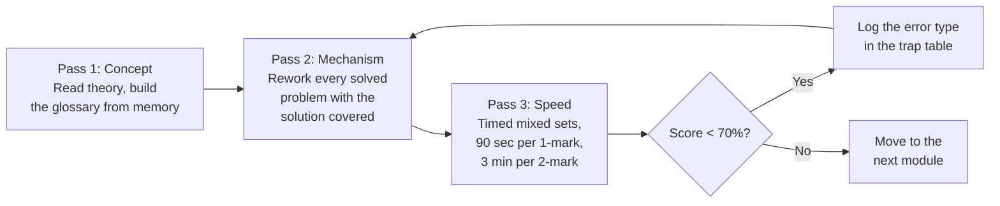

# Engineering Mathematics for GATE 2027 — Part 3
## Probability & Statistics, plus Exam Strategy

*Companion to Part 1 (Discrete Mathematics) and Part 2 (Linear Algebra & Calculus). Every numeric result below was computed in a Python sandbox, including exact fractions where they matter.*

---

# MODULE 4 — PROBABILITY AND STATISTICS

Probability quantifies **uncertainty** on a scale from 0 (impossible) to 1 (certain). Statistics works in the opposite direction: from observed data back to the underlying mechanism.

## 4.0 Module glossary

| Symbol | Meaning |
|---|---|
| $S$ | Sample space — the set of all possible outcomes |
| $E$ | Event — any subset of $S$ |
| $P(E)$ | Probability of event $E$, with $0\le P(E)\le1$ |
| $E^c$ or $\bar E$ | Complement — "$E$ does not occur" |
| $P(A\mid B)$ | Conditional probability of $A$ **given** $B$ has occurred |
| $X$ | Random variable (capital letter) |
| $x$ | A specific value $X$ takes (lowercase) |
| $E[X]$ or $\mu$ | Expected value (mean) |
| $\operatorname{Var}(X)$ or $\sigma^2$ | Variance |
| $\sigma$ | Standard deviation $=\sqrt{\operatorname{Var}(X)}$ |
| $f(x)$ | Probability density function (continuous) |
| $F(x)$ | Cumulative distribution function, $P(X\le x)$ |
| $\lambda$ | Rate parameter (Poisson, exponential) |
| $\sim$ | "is distributed as" |

---

## 4.1 Foundations

### 4.1.1 The basic vocabulary

A **random experiment** has an uncertain outcome. The **sample space** $S$ lists every possible outcome; an **event** is any subset of $S$. For a fair die, $S=\{1,2,3,4,5,6\}$ and "even" is the event $\{2,4,6\}$.

**Classical definition** (equally likely outcomes):
$$P(E)=\frac{\text{number of favourable outcomes}}{\text{total number of outcomes}}=\frac{|E|}{|S|}$$

**Axioms** (Kolmogorov) — everything else is derived from these three:
1. $P(E)\ge0$ for every event.
2. $P(S)=1$.
3. For **mutually exclusive** events, $P(A\cup B)=P(A)+P(B)$.

**Derived rules:**
- $P(E^c)=1-P(E)$. *Always consider this first* — "at least one" problems are nearly always easier as $1-P(\text{none})$.
- **Addition rule:** $P(A\cup B)=P(A)+P(B)-P(A\cap B)$. (Inclusion–exclusion again.)
- $P(\emptyset)=0$.

### 4.1.2 Conditional probability and independence

$$P(A\mid B)=\frac{P(A\cap B)}{P(B)},\qquad P(B)>0$$
Conditioning **shrinks the sample space** to $B$; you are re-measuring $A$ inside that smaller world. That one sentence is the entire concept.

**Multiplication rule:** $P(A\cap B)=P(A\mid B)P(B)=P(B\mid A)P(A)$.

**Independence:** $A$ and $B$ are independent iff $P(A\cap B)=P(A)P(B)$, equivalently $P(A\mid B)=P(A)$ — knowing $B$ tells you nothing about $A$.

> **Independent ≠ mutually exclusive.** These are nearly opposites. Mutually exclusive events with non-zero probability are *strongly dependent*: if one happens, the other definitely did not. Confusing the two is the most frequent conceptual error in this module.

**Law of total probability.** If $B_1,\dots,B_n$ partition $S$:
$$P(A)=\sum_{i=1}^{n}P(A\mid B_i)P(B_i)$$

### 4.1.3 Bayes' theorem

$$\boxed{P(B_i\mid A)=\frac{P(A\mid B_i)P(B_i)}{\sum_{j}P(A\mid B_j)P(B_j)}}$$

| Term | Name | Meaning |
|---|---|---|
| $P(B_i)$ | **Prior** | belief before seeing evidence |
| $P(A\mid B_i)$ | **Likelihood** | how well hypothesis $B_i$ explains the evidence |
| $P(B_i\mid A)$ | **Posterior** | updated belief after the evidence |
| denominator | **Evidence** | normaliser so the posteriors sum to 1 |

Bayes reverses the direction of conditioning: it converts "probability of the symptom given the disease" into "probability of the disease given the symptom". These two are wildly different numbers, and believing otherwise is the *base rate fallacy* — demonstrated in Problem 4.2.

### 4.1.4 Worked problems

**Problem 4.1 (1 mark).** Two fair dice are thrown. Find $P(\text{sum}=7)$ and $P(\text{sum}=7\mid\text{first die is even})$. Are the events independent?

*Solution.* $|S|=36$. Sum 7 occurs as $(1,6),(2,5),(3,4),(4,3),(5,2),(6,1)$ — 6 outcomes:
$$P(\text{sum}=7)=\tfrac{6}{36}=\tfrac16$$
Given the first die is even (18 outcomes), the favourable ones are $(2,5),(4,3),(6,1)$ — 3 outcomes:
$$P(\text{sum}=7\mid\text{first even})=\tfrac{3}{18}=\tfrac16$$
The two are **equal**, so the events are **independent** *(both fractions machine-verified)*. Intuition: whatever the first die shows, exactly one value of the second completes a 7, giving probability $\tfrac16$ regardless. ∎

**Problem 4.2 (2 marks).** A disease affects 1% of a population. A test has 99% sensitivity (detects the disease when present) and a 5% false-positive rate. A randomly chosen person tests positive. What is the probability they have the disease?

*Solution.* Let $D$ = has disease, $+$ = tests positive.
Given: $P(D)=0.01$, $P(D^c)=0.99$, $P(+\mid D)=0.99$, $P(+\mid D^c)=0.05$.

**Step 1 — evidence (law of total probability).**
$$P(+)=P(+\mid D)P(D)+P(+\mid D^c)P(D^c)=(0.99)(0.01)+(0.05)(0.99)=0.0099+0.0495=0.0594$$

**Step 2 — Bayes.**
$$P(D\mid+)=\frac{0.0099}{0.0594}=\frac{1}{6}\approx0.1667$$

**Answer: $\tfrac16 \approx 16.67\%$** *(computed in exact rational arithmetic).*

**Why this is counter-intuitive.** The test is 99% sensitive, yet a positive result means only a 1-in-6 chance of disease. The reason is the **base rate**: in a population of 10,000 there are only 100 sick people (99 of whom test positive) but 9,900 healthy people (495 of whom test positive anyway). The 495 false positives swamp the 99 true positives. The rarer the disease, the more false positives dominate. ∎

**Problem 4.3 (1 mark).** A die is rolled 4 times. What is the probability of at least one six?

*Solution.* Use the complement — "at least one" is the signal to do so.
$$P(\text{no six in one roll})=\tfrac56 \Rightarrow P(\text{no six in four rolls})=\left(\tfrac56\right)^4=\tfrac{625}{1296}$$
$$P(\text{at least one six})=1-\tfrac{625}{1296}=\tfrac{671}{1296}\approx\mathbf{0.5177}$$
*(Exact fraction machine-verified.)* ∎

---

## 4.2 Random Variables

### 4.2.1 Definition

A **random variable** $X$ is a function assigning a number to each outcome. It converts outcomes into arithmetic.

- **Discrete:** takes countably many values (dice, counts, defects). Described by a **probability mass function** $p(x)=P(X=x)$ with $\sum p(x)=1$.
- **Continuous:** takes any value in an interval (time, height, voltage). Described by a **probability density function** $f(x)\ge0$ with $\int_{-\infty}^{\infty}f(x)dx=1$.

> For a continuous variable, $P(X=c)=0$ for every single point. Probability lives in *intervals*: $P(a\le X\le b)=\int_a^bf(x)dx$. Density is not probability — it is probability *per unit length*, and may exceed 1.

**Cumulative distribution function (CDF):** $F(x)=P(X\le x)$, non-decreasing from 0 to 1. In the continuous case $F'(x)=f(x)$.

### 4.2.2 Expectation and variance

$$E[X]=\sum_x x\,p(x) \quad\text{(discrete)},\qquad E[X]=\int_{-\infty}^{\infty}xf(x)dx \quad\text{(continuous)}$$
The mean is the long-run average, the "balance point" of the distribution.

$$\operatorname{Var}(X)=E\big[(X-\mu)^2\big]=\underbrace{E[X^2]-\big(E[X]\big)^2}_{\text{the computational form — use this}}$$
Variance measures spread in *squared* units; the standard deviation $\sigma=\sqrt{\operatorname{Var}(X)}$ restores the original units, which is why it is the quantity usually reported.

**Key properties** ($a,b$ constants):
$$E[aX+b]=aE[X]+b,\qquad \operatorname{Var}(aX+b)=a^2\operatorname{Var}(X)$$
Adding a constant shifts the mean but **not** the spread. $E[X+Y]=E[X]+E[Y]$ **always** (even for dependent variables — a surprisingly powerful fact), but $\operatorname{Var}(X+Y)=\operatorname{Var}(X)+\operatorname{Var}(Y)$ **only when independent**.

---

## 4.3 The Five Named Distributions

GATE names exactly five. Learn each by its *generating story* — then you never have to guess which formula applies.

### 4.3.1 Binomial — "how many successes in $n$ fixed trials?"

**Story:** $n$ independent trials, each succeeding with probability $p$. $X$ counts successes.
$$P(X=k)=\binom{n}{k}p^k(1-p)^{n-k},\quad k=0,1,\dots,n$$
$$E[X]=np,\qquad \operatorname{Var}(X)=np(1-p)$$
The three pieces: $\binom nk$ counts *which* trials succeeded, $p^k$ is their probability, $(1-p)^{n-k}$ covers the failures.
*Special case:* $n=1$ is the **Bernoulli** distribution.

### 4.3.2 Poisson — "how many rare events in a fixed interval?"

**Story:** events occur independently at a constant average rate $\lambda$ per interval; $X$ counts occurrences (packets per second, defects per metre, calls per hour).
$$P(X=k)=\frac{e^{-\lambda}\lambda^k}{k!},\quad k=0,1,2,\dots$$
$$E[X]=\lambda,\qquad \operatorname{Var}(X)=\lambda$$
> Mean = variance is Poisson's fingerprint. If a question states both and they are equal, it is Poisson.

**Poisson approximation to the binomial:** when $n$ is large and $p$ small with $\lambda=np$ moderate, the binomial is well approximated by Poisson.

### 4.3.3 Uniform — "every value equally likely"

**Continuous on $[a,b]$:**
$$f(x)=\frac{1}{b-a}\ \text{for }a\le x\le b,\qquad E[X]=\frac{a+b}{2},\qquad \operatorname{Var}(X)=\frac{(b-a)^2}{12}$$
A flat rectangle of total area 1. The $\tfrac1{12}$ is worth memorising outright.

### 4.3.4 Exponential — "how long until the next event?"

**Story:** the waiting time between Poisson events (inter-arrival time, component lifetime).
$$f(x)=\lambda e^{-\lambda x},\ x\ge0;\qquad F(x)=1-e^{-\lambda x};\qquad P(X>x)=e^{-\lambda x}$$
$$E[X]=\frac1\lambda,\qquad \operatorname{Var}(X)=\frac1{\lambda^2}$$

**Memorylessness** — the defining property, unique to the exponential among continuous distributions:
$$P(X>s+t\mid X>s)=P(X>t)$$
A component that has already survived $s$ hours is *exactly as good as new*. The distribution has no concept of wear. (Its discrete counterpart is the geometric distribution.)

### 4.3.5 Normal (Gaussian) — "the sum of many small effects"

$$f(x)=\frac{1}{\sigma\sqrt{2\pi}}\,e^{-\frac{(x-\mu)^2}{2\sigma^2}}$$
Symmetric and bell-shaped about $\mu$, with $E[X]=\mu$, $\operatorname{Var}(X)=\sigma^2$, and mean = median = mode.

**Standardisation** — convert any normal to the standard normal $Z\sim N(0,1)$:
$$Z=\frac{X-\mu}{\sigma}$$
$Z$ counts *how many standard deviations above the mean* a value lies, which is what makes a single $Z$-table serve every normal distribution.

**The empirical (68–95–99.7) rule** — machine-computed to 6 decimals:

| Range | Exact probability |
|---|---|
| $\mu\pm1\sigma$ | 0.682689 |
| $\mu\pm2\sigma$ | 0.954500 |
| $\mu\pm3\sigma$ | 0.997300 |

**Central Limit Theorem.** The sample mean of $n$ independent, identically distributed variables (any distribution, finite variance) approaches a normal distribution as $n$ grows, with mean $\mu$ and standard deviation $\sigma/\sqrt n$. This is *why* the normal distribution appears everywhere in engineering measurement.

### 4.3.6 Distribution selection table

| Question being asked | Distribution | Mean | Variance |
|---|---|---|---|
| How many successes in $n$ fixed trials? | Binomial$(n,p)$ | $np$ | $np(1-p)$ |
| How many rare events per interval? | Poisson$(\lambda)$ | $\lambda$ | $\lambda$ |
| Any value in a range, equally likely? | Uniform$(a,b)$ | $\frac{a+b}{2}$ | $\frac{(b-a)^2}{12}$ |
| How long until the next event? | Exponential$(\lambda)$ | $\frac1\lambda$ | $\frac1{\lambda^2}$ |
| Measurement with symmetric error? | Normal$(\mu,\sigma^2)$ | $\mu$ | $\sigma^2$ |

### 4.3.7 Worked problems

**Problem 4.4 (2 marks).** $X\sim\text{Binomial}(n=10,\ p=0.3)$. Find $P(X=3)$, $P(X\le2)$, $E[X]$ and $\operatorname{Var}(X)$.

*Solution.*
$$P(X=3)=\binom{10}{3}(0.3)^3(0.7)^7=120\times0.027\times0.0823543=\mathbf{0.266828}$$
$$P(X\le2)=P(0)+P(1)+P(2)=\mathbf{0.382783}$$
$$E[X]=np=10(0.3)=\mathbf{3},\qquad \operatorname{Var}(X)=np(1-p)=10(0.3)(0.7)=\mathbf{2.1}$$
*(All values machine-computed; the full pmf was also verified to sum to exactly 1.)*
Note $P(X=3)$ is the largest single probability, which makes sense — the mean is 3. ∎

**Problem 4.5 (2 marks).** Calls arrive at a switchboard at an average of 2 per minute, Poisson distributed. Find $P(\text{exactly }0)$, $P(\text{exactly }2)$ and $P(\text{at least }1)$ in a given minute.

*Solution.* $\lambda=2$.
$$P(X=0)=e^{-2}=\mathbf{0.135335}$$
$$P(X=2)=\frac{e^{-2}2^2}{2!}=2e^{-2}=\mathbf{0.270671}$$
$$P(X\ge1)=1-P(X=0)=1-0.135335=\mathbf{0.864665}$$
*(Machine-computed.)* Note $P(X=1)=P(X=2)=0.270671$ exactly — a quirk that occurs whenever $\lambda=2$, since $P(X=k)/P(X=k-1)=\lambda/k$ equals 1 at $k=\lambda$. ∎

**Problem 4.6 (2 marks).** A bulb's lifetime is exponential with mean 5 years. Find $P(\text{lasts}>8\text{ years})$, and $P(\text{lasts}>13\mid\text{already lasted }5)$.

*Solution.* Mean $=1/\lambda=5 \Rightarrow \lambda=0.2$.
$$P(X>8)=e^{-0.2\times8}=e^{-1.6}=\mathbf{0.201897}$$
By memorylessness,
$$P(X>13\mid X>5)=P(X>8)=e^{-1.6}=\mathbf{0.201897}$$
*(Both machine-computed and confirmed identical.)* The bulb's five years of service left no trace — the exponential model has no ageing. ∎

**Problem 4.7 (2 marks).** Exam marks are $N(\mu=70,\ \sigma=8)$. What fraction of students score above 86?

*Solution.* Standardise:
$$Z=\frac{86-70}{8}=2$$
So $P(X>86)=P(Z>2)=\tfrac12\big(1-P(|Z|<2)\big)=\tfrac12(1-0.9545)=\mathbf{0.02275}$, about **2.3%**.
*(Machine-computed via the error function.)* This matches the empirical rule: 95.45% lie within $\pm2\sigma$, leaving 4.55% in the two tails, and half of that — 2.27% — is in the upper tail alone. ∎

**Problem 4.8 (1 mark).** $X\sim\text{Uniform}(2,10)$. Find the mean, variance and $P(X>7)$.

*Solution.*
$$E[X]=\frac{2+10}{2}=\mathbf{6},\qquad \operatorname{Var}(X)=\frac{(10-2)^2}{12}=\frac{64}{12}=\mathbf{5.3333}$$
$$P(X>7)=\frac{10-7}{10-2}=\frac38=\mathbf{0.375}$$
*(Machine-verified.)* For a uniform distribution, probability is just the fraction of the interval's length. ∎

---

## 4.4 Descriptive Statistics

### 4.4.1 Measures of central tendency

| Measure | Definition | Best used when |
|---|---|---|
| **Mean** $\bar x=\frac{1}{n}\sum x_i$ | arithmetic average | data is symmetric; uses every value |
| **Median** | middle value of the sorted data (average the two middle values if $n$ is even) | data is **skewed or has outliers** — it is robust |
| **Mode** | most frequent value | categorical data; may not exist or may be multiple |

Outlier sensitivity: adding one extreme value can move the mean arbitrarily far, while the median barely shifts. For right-skewed data, typically mean > median > mode.

### 4.4.2 Measures of dispersion

- **Range** = max − min. Simple, but uses only two values.
- **Population variance:** $\sigma^2=\frac{1}{n}\sum(x_i-\bar x)^2$
- **Sample variance:** $s^2=\frac{1}{n-1}\sum(x_i-\bar x)^2$

> **Why $n-1$?** When estimating the spread of a population from a sample, you have already used the data to estimate the mean, consuming one **degree of freedom**. Dividing by $n$ would systematically under-estimate the true variance; $n-1$ corrects that bias (Bessel's correction). GATE expects the population formula unless the word "sample" appears.

**Computational shortcut** (far faster by hand): $\sigma^2=\dfrac{\sum x_i^2}{n}-\bar x^2$.

**Coefficient of variation** $=\sigma/\bar x$ — a unitless relative spread, letting you compare dispersion across different scales.

### 4.4.3 Worked problem

**Problem 4.9 (2 marks).** For the data $\{4,8,6,5,3,8,9,1\}$ find the mean, median, mode, population variance and both standard deviations.

*Solution.*
**Sorted:** $1,3,4,5,6,8,8,9$ ($n=8$).

**Mean:** $\dfrac{4+8+6+5+3+8+9+1}{8}=\dfrac{44}{8}=\mathbf{5.5}$

**Median:** $n$ is even, so average the 4th and 5th sorted values: $\dfrac{5+6}{2}=\mathbf{5.5}$

**Mode:** $8$ appears twice, every other value once ⟹ mode $=\mathbf 8$

**Population variance** via the shortcut. $\sum x_i^2 = 16+64+36+25+9+64+81+1=296$:
$$\sigma^2=\frac{296}{8}-(5.5)^2=37-30.25=\mathbf{6.75}$$
*(Machine-verified both by the definition and by the $E[X^2]-\mu^2$ shortcut — they agree at 6.75.)*

**Population SD:** $\sigma=\sqrt{6.75}=\mathbf{2.598076}$
**Sample SD:** $s=\sqrt{\frac{8}{7}\times6.75}=\sqrt{7.714286}=\mathbf{2.774460}$

*(All machine-computed.)* The sample SD is larger, as Bessel's correction guarantees. Mean = median here, indicating a roughly symmetric distribution. ∎

---

## 4.5 Module 4 visuals

> **Diagram D4.1 — The 36-cell dice grid.** A $6\times6$ grid of all two-dice outcomes, each cell labelled with its sum and colour-coded by value. The anti-diagonal summing to 7 is outlined in gold (6 cells = $\tfrac16$). Overlay a translucent band on the three even-first-die rows, showing 3 gold cells out of 18 — the same $\tfrac16$ — so independence is *seen*, not computed.

> **Diagram D4.2 — Bayes as a population of 10,000 (the single best anti-fallacy tool).** A $100\times100$ dot grid. 100 dots are red (diseased), 9,900 grey (healthy). Dots that test positive get a ring: 99 of the 100 red, and 495 of the 9,900 grey. A callout lassoes **all ringed dots** (594 total) and asks "of these, how many are red?" — answer 99, giving $99/594=1/6$. Converting Bayes to raw counts makes the base rate fallacy evaporate.

> **Diagram D4.3 — Independent vs mutually exclusive.** Two Venn pairs side by side. Left: overlapping circles labelled "independent — $P(A\cap B)=P(A)P(B)$, the overlap is exactly proportional." Right: disjoint circles labelled "mutually exclusive — $P(A\cap B)=0$, so knowing one occurred tells you the other did not: maximally **dependent**." A red "≠" sits between the panels.

> **Diagram D4.4 — Distribution gallery.** Five plots in a row, each with its story in the caption and its mean marked by a dashed vertical: Binomial(10, 0.3) as a bar chart peaking at 3; Poisson(2) as bars with the equal $k=1,2$ bars highlighted; Uniform(2,10) as a flat rectangle of height $\tfrac18$; Exponential(0.2) as a decaying curve with the area beyond $x=8$ shaded; Normal(70,8) as a bell with the region beyond 86 shaded in the tail. Each annotated with its mean and variance formula — a single revision sheet for Section 4.3.

> **Diagram D4.5 — The empirical rule bell.** A standard normal curve partitioned at $\pm1\sigma,\pm2\sigma,\pm3\sigma$, each band shaded a different tint and labelled with its exact area (34.13%, 13.59%, 2.14% per side) and the cumulative figures 68.27% / 95.45% / 99.73%. Add a $Z$-score ruler beneath the $x$-axis so standardisation is visually tied to the picture.

> **Diagram D4.6 — Mean, median, mode under skew.** Three density curves: left-skewed, symmetric, right-skewed. On each, three vertical markers show the ordering of the three measures — for the right-skewed curve, mode < median < mean, with an arrow showing the long tail "dragging the mean" toward it. Instantly explains why median is the honest measure for incomes and response times.

> **Animation A4.1 — The Law of Large Numbers.** A coin flips repeatedly; a running plot of the cumulative proportion of heads oscillates wildly over the first 20 flips, then converges on the 0.5 line by flip 5,000. Caption: "probability is a long-run frequency, not a promise about the next flip." Cures the gambler's fallacy in one viewing.

> **Animation A4.2 — Bayesian updating.** A prior bar (1% diseased) sits beside a posterior bar. As evidence arrives — positive test, then a second independent positive test — the posterior bar grows in steps: 1% → 16.7% → 79.9%. A tug-of-war graphic shows likelihood pulling against the base rate. Teaches that one test is weak evidence for a rare condition while two are strong.

> **Animation A4.3 — The Central Limit Theorem machine.** The top panel shows a deliberately non-normal population (a bimodal or heavily skewed distribution). Samples of size $n$ are repeatedly drawn and their means dropped into a histogram below. With $n=1$ the histogram mirrors the ugly population; sliding $n$ to 5, then 30, the histogram visibly morphs into a bell and narrows by $1/\sqrt n$. The most important animation in the module — it explains why normality is ubiquitous.

> **Animation A4.4 — Memorylessness.** An exponential survival curve with a component "aged" by a sliding marker at $s$. As the marker moves right, the remaining curve is rescaled and overlaid on the original — they coincide **exactly**, every time. Caption: "surviving 5 years changes nothing; the component is as good as new." Then contrast with a Weibull wear-out curve where the overlay clearly fails.

> **Animation A4.5 — Binomial converging to Poisson and Normal.** Start with Binomial($n$, $p$) and hold $np=\lambda=3$ fixed while $n$ climbs from 10 to 1,000 (so $p$ shrinks); the bars settle onto the Poisson(3) outline. In a second mode, hold $p=0.5$ and increase $n$; the bars settle under a normal curve. Shows the three discrete/continuous distributions as one connected family rather than three memorised formulas.

---
---

# PART 5 — EXAM STRATEGY AND REVISION APPARATUS

## 5.1 Master formula sheet

**Discrete Mathematics**
$$p\rightarrow q\equiv\neg p\vee q \qquad \neg\forall x\,P \equiv \exists x\,\neg P \qquad |A\cup B|=|A|+|B|-|A\cap B|$$
$$|\mathcal P(A)|=2^n \qquad \textstyle\sum_v \deg(v)=2m \qquad n-m+f=2 \qquad m\le 3n-6 \text{ (planar)}$$
$$\binom nr=\frac{n!}{r!(n-r)!} \qquad \text{stars and bars: }\binom{n+k-1}{k-1} \qquad \text{Cayley: } n^{n-2}$$

**Linear Algebra**
$$\det\begin{bmatrix}a&b\\c&d\end{bmatrix}=ad-bc \qquad A^{-1}=\tfrac{1}{\det A}\operatorname{adj}A \qquad \det(A)=\textstyle\prod\lambda_i \qquad \operatorname{tr}(A)=\textstyle\sum\lambda_i$$
$$\det(A-\lambda I)=0 \qquad \lambda^2-\operatorname{tr}(A)\lambda+\det(A)=0 \ (2\times2) \qquad A=LU$$

**Calculus**
$$\lim_{x\to0}\tfrac{\sin x}{x}=1 \qquad f'(c)=\tfrac{f(b)-f(a)}{b-a} \qquad \int u\,dv=uv-\int v\,du \qquad \int_a^b f=F(b)-F(a)$$

**Probability**
$$P(A\mid B)=\tfrac{P(A\cap B)}{P(B)} \qquad P(B_i\mid A)=\tfrac{P(A\mid B_i)P(B_i)}{\sum_j P(A\mid B_j)P(B_j)} \qquad \operatorname{Var}(X)=E[X^2]-(E[X])^2$$

## 5.2 The traps that cost the most marks

| # | Trap | The correct position |
|---|---|---|
| 1 | Treating $p\rightarrow q$ as false when $p$ is false | It is **true** — vacuous truth |
| 2 | Assuming the converse follows from an implication | Only the **contrapositive** is equivalent |
| 3 | Swapping $\forall x\exists y$ and $\exists y\forall x$ | $\exists\forall$ is strictly stronger |
| 4 | "Antisymmetric = not symmetric" | They are independent properties; equality is both |
| 5 | Maximal matching vs maximum matching | Maximal = cannot extend; maximum = largest overall |
| 6 | Assuming $AB=BA$ | Matrix multiplication is **not** commutative |
| 7 | Forgetting that $\det=0$ means singular | No inverse, dependent rows, non-trivial null space |
| 8 | Assuming a parameter must cause inconsistency | Check $r$ vs $r_a$ — often it never does (Problem 2.2) |
| 9 | Continuous ⟹ differentiable | False; $|x|$ at 0 is the standard counterexample |
| 10 | Omitting endpoints in absolute extrema | Always test critical points **and** endpoints |
| 11 | Applying L'Hôpital to a determinate form | Only valid for $\tfrac00$ and $\tfrac\infty\infty$ |
| 12 | Independent = mutually exclusive | Nearly opposite notions |
| 13 | Confusing $P(+\mid D)$ with $P(D\mid+)$ | Bayes exists precisely to convert between them |
| 14 | Dividing by $n$ for a sample variance | Use $n-1$ when the question says "sample" |

## 5.3 Three-pass revision method

**Error log discipline.** Maintain a single sheet with four columns: *question · my answer · correct answer · which of the 14 traps it was*. After three weeks, patterns become obvious and revision becomes targeted rather than generic. This is the highest-return study habit available for GATE.

## 5.4 Self-check — can you do these unaided?

- [ ] State the one row where $p\rightarrow q$ is false, without looking.
- [ ] Negate $\forall x\exists y\,(P(x)\rightarrow Q(y))$ in one step.
- [ ] Count equivalence relations on a 4-element set (answer: 15).
- [ ] Explain why $D_{36}$ is a lattice but not a Boolean algebra.
- [ ] Apply handshaking to find $n$ for a 3-regular graph with 12 edges (answer: 8).
- [ ] Prove $K_{3,3}$ non-planar using $m\le2n-4$.
- [ ] Solve a two-term linear recurrence by the characteristic root method.
- [ ] State the consistency rule in terms of $r$, $r_a$ and $n$.
- [ ] Find eigenvalues of a $2\times2$ matrix using trace and determinant in under 30 seconds.
- [ ] Produce $L$ and $U$ for a $3\times3$ matrix and solve by two substitutions.
- [ ] Give a function that is continuous but not differentiable, and say exactly why.
- [ ] State all three hypotheses of Rolle's theorem and a counterexample when one fails.
- [ ] Integrate $x^2e^x$ by parts twice without hesitation.
- [ ] Recompute the 1-in-6 answer of the disease-testing problem from scratch.
- [ ] Name the distribution whose mean equals its variance (Poisson).
- [ ] State the memoryless property and the one continuous distribution with it.
- [ ] Explain the $n-1$ in the sample variance.

Any unchecked box is your next study session. 🎯
